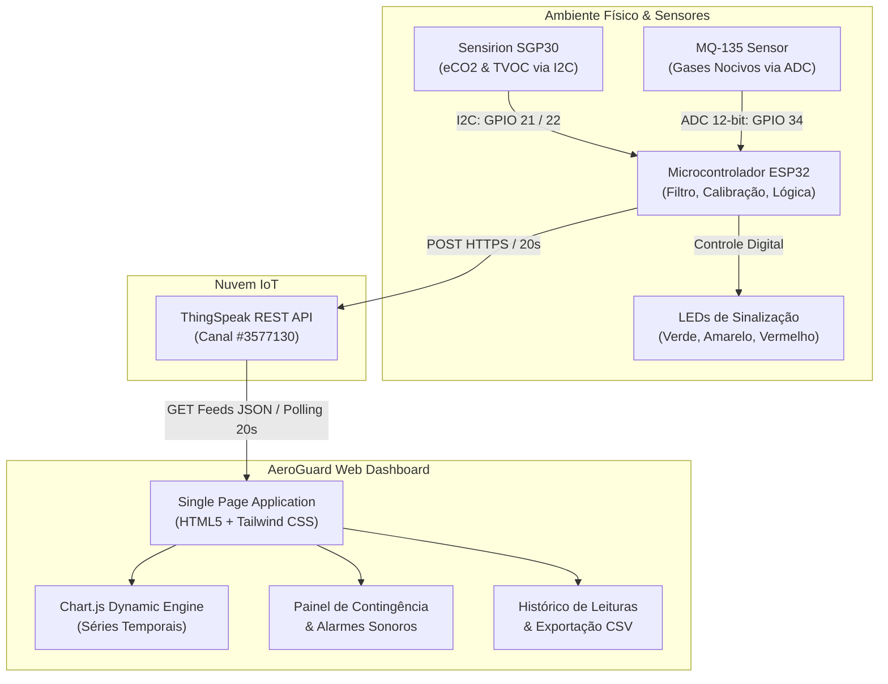

# 🍃 AeroGuard | Monitoramento Inteligente da Qualidade do Ar com ESP32

[](https://espressif.com/)
[](https://thingspeak.com/channels/3577130)
[](https://tailwindcss.com/)
[](https://www.chartjs.org/)
[](https://www.conventionalcommits.org/)
[](LICENSE)

Sistema IoT completo para monitoramento em tempo real da qualidade do ar em ambientes internos, integrando **ESP32**, sensores especializados (**SGP30** e **MQ-135**), nuvem **ThingSpeak** e um moderno **Dashboard Web Single Page Application (SPA)** com Tailwind CSS e Chart.js.

---

## 📌 Sumário
- [Visão Geral](#-visão-geral)
- [Arquitetura do Sistema](#-arquitetura-do-sistema)
- [Pinout e Esquemático de Hardware](#-pinout-e-esquemático-de-hardware)
- [Sensores e Métricas Monitoradas](#-sensores-e-métricas-monitoradas)
- [Matriz de Limites e Classificação](#-matriz-de-limites-e-classificação)
- [Estrutura do Repositório](#-estrutura-do-repositório)
- [Configuração do ThingSpeak](#-configuração-do-thingspeak)
- [Guia de Instalação e Execução](#-guia-de-instalação-e-execução)
  - [1. Firmware do ESP32](#1-firmware-do-esp32)
  - [2. Dashboard Web](#2-dashboard-web)
- [Padrão de Commits](#-padrão-de-commits)
- [Licença e Autoria](#-licença-e-autoria)

---

## 🔍 Visão Geral

O projeto **AeroGuard** foi concebido para fornecer alerta precoce e diagnóstico contínuo da atmosfera em ambientes fechados (laboratórios, escritórios, residências e salas de servidores). 

O microcontrolador ESP32 realiza leituras contínuas, calcula a variação em relação ao baseline calibrado, filtra ruídos elétricos via amostragem ponderada e classifica o estado do ar em 5 níveis normativos. Os dados são sincronizados a cada **20 segundos** via HTTPS na plataforma IoT ThingSpeak e apresentados em um painel web intuitivo com gráficos temporais, tabela de histórico, exportação CSV e alertas audiovisuais.

---

## 🏗 Arquitetura do Sistema



---

## 🔌 Pinout e Esquemático de Hardware

| Componente | Pino no Sensor/Periférico | Pino no ESP32 | Função / Protocolo |
| :--- | :--- | :--- | :--- |
| **Sensirion SGP30** | VCC | 3V3 | Alimentação 3.3V |
| **Sensirion SGP30** | GND | GND | Terra comum |
| **Sensirion SGP30** | SDA | **GPIO 21** | Barramento de dados I2C |
| **Sensirion SGP30** | SCL | **GPIO 22** | Barramento de clock I2C |
| **Sensor MQ-135** | VCC | 5V (VIN) | Aquecimento do filamento interno |
| **Sensor MQ-135** | GND | GND | Terra comum |
| **Sensor MQ-135** | AOUT | **GPIO 34** | Leitura analógica (ADC1_CH6 - 12 bits) |
| **LED Verde** | Ânodo (+) | **GPIO 25** | Indicador: Nível < 2 (Ar Excelente/Bom) |
| **LED Amarelo** | Ânodo (+) | **GPIO 27** | Indicador: Nível 2 (Atenção / Moderado) |
| **LED Vermelho** | Ânodo (+) | **GPIO 26** | Indicador: Nível &ge; 3 (Ruim / Crítico) |

> ⚠️ **Atenção:** Os LEDs devem ter resistores limitadores de corrente em série (220Ω ou 330Ω). O pino GPIO 34 do ESP32 é somente entrada analógica (*Input-only*).

---

## 📊 Sensores e Métricas Monitoradas

1. **Sensirion SGP30:**
   - **eCO2 (Dióxido de Carbono Equivalente):** Calculado com base nos níveis de hidrogênio gerados pela respiração humana. Faixa: 400 a 60.000 ppm.
   - **TVOC (Compostos Orgânicos Voláteis Totais):** Mede compostos derivados de solventes, tintas, cosméticos, álcool e fumaça. Faixa: 0 a 60.000 ppb.
2. **Sensor MQ-135:**
   - **Variação de Tensão ($\Delta V$):** Medição da variação de potencial elétrico em relação ao baseline estabilizado nos primeiros 30 segundos de inicialização. Detecta amônia ($\text{NH}_3$), sulfetos, fumaça e óxidos de nitrogênio ($\text{NO}_x$).
3. **Rotina de Calibração Inicial:**
   - Nos primeiros 30 segundos pós-inicialização, o ESP32 pisca os LEDs ciclicamente enquanto colhe amostras da tensão do MQ-135 e estabiliza o algoritmo IAQ do SGP30 para definir a linha de base de referência.

---

## 📈 Matriz de Limites e Classificação

O firmware calcula o nível individual de cada sensor e adota o **maior índice (pior caso)** como nível geral:

$$\text{Nível Geral} = \max(\text{Nível}_{\text{TVOC}},\, \text{Nível}_{\text{eCO2}},\, \text{Nível}_{\text{MQ135}})$$

| Nível | Status | eCO2 (ppm) | TVOC (ppb) | MQ-135 $\Delta V$ (Volts) | LEDs Físicos | Ação Recomendada |
| :---: | :---: | :---: | :---: | :---: | :---: | :--- |
| **0** | **EXCELENTE** | $< 600$ | $< 65$ | $< 0.05$ | Verde | Ambiente ideal. Nenhuma intervenção requerida. |
| **1** | **BOA** | $600 - 999$ | $65 - 219$ | $0.05 - 0.09$ | Verde | Qualidade satisfatória para permanência contínua. |
| **2** | **MODERADA** | $1000 - 1499$ | $220 - 659$ | $0.10 - 0.19$ | Amarelo | Atenção. Iniciar ventilação natural abrindo janelas. |
| **3** | **RUIM** | $1500 - 2499$ | $660 - 2199$ | $0.20 - 0.34$ | Vermelho | Alerta. Ativar exaustores e verificar fontes poluidoras. |
| **4** | **MUITO RUIM** | $\ge 2500$ | $\ge 2200$ | $\ge 0.35$ | Vermelho | Perigo iminente. Evacuar o local imediatamente. |

---

## 📂 Estrutura do Repositório

```plaintext
Monitoramento-Qualidade-do-Ar-Esp32/
├── firmware/
│   └── main.ino          # Firmware C++ completo para ESP32 (SGP30, MQ-135, ThingSpeak)
├── web/
│   ├── index.html        # Estrutura semântica SPA do Dashboard com abas e badges
│   ├── styles.css        # Estilos customizados Dark Mode, animações LED e glassmorphism
│   └── app.js            # Integração ThingSpeak, gráficos Chart.js, alarmes e CSV
└── README.md             # Documentação técnica e arquitetural completa do projeto
```

---

## ☁️ Configuração do ThingSpeak

- **Canal Público:** `3577130`
- **Nome do Canal:** `ESP32-monitoramento`
- **Mapeamento de Canais:**
  - `field1`: **eCO2** *(ppm)*
  - `field2`: **TVOC** *(ppb)*
  - `field3`: **MQ135** *($\Delta V$ em Volts)*
  - `field4`: **Alerta** *(0 = Normal, 1 = Alerta Ativo)*
  - `field5`: **Nível Geral** *(0 a 4 conforme a matriz de severidade)*
- **Endpoint REST:**
  ```http
  GET https://api.thingspeak.com/channels/3577130/feeds.json?api_key=86735BGSD3R77O2F&results=30
  ```

---

## 🚀 Guia de Instalação e Execução

### 1. Firmware do ESP32

1. Instale o [Arduino IDE](https://www.arduino.cc/en/software).
2. Adicione o suporte para placas ESP32:
   - Vá em **Arquivo > Preferências > URLs Adicionais para Gerenciadores de Placas**:
     ```
     https://raw.githubusercontent.com/espressif/arduino-esp32/gh-pages/package_esp32_index.json
     ```
3. Instale as bibliotecas necessárias pelo Gerenciador de Bibliotecas:
   - **Adafruit SGP30 Sensor** (by Adafruit)
   - **Adafruit BusIO** (dependência automática)
4. Abra o arquivo `firmware/main.ino`.
5. Se necessário, ajuste as credenciais Wi-Fi no código:
   ```cpp
   const char* ssid = "SEU_SSID";
   const char* password = "SUA_SENHA";
   ```
6. Selecione a placa **ESP32 Dev Module**, conecte o cabo USB e clique em **Carregar (Upload)**.
7. Abra o Serial Monitor a **115200 baud** para acompanhar a calibração de 30s e o envio dos pacotes.

### 2. Dashboard Web

A aplicação web é uma Single Page Application estática e não necessita de servidores complexos de backend:
1. Navegue até a pasta `/web`.
2. Abra o arquivo `index.html` diretamente no seu navegador preferido (Google Chrome, Edge, Firefox).
3. Ou execute via servidor local de desenvolvimento (ex.: extensão *Live Server* do VS Code ou via Python):
   ```bash
   cd web
   python -m http.server 8000
   ```
   Acesse: `http://localhost:8000`

---

## 📝 Padrão de Commits

O repositório adota rigorosamente a especificação [Conventional Commits](https://www.conventionalcommits.org/):

1. `feat(firmware): add ESP32 C++ code for SGP30, MQ135 and ThingSpeak integration`
2. `feat(web): setup HTML dashboard structure and layout`
3. `style(web): apply dark mode design and Tailwind CSS styling`
4. `feat(web): integrate ThingSpeak API polling every 20 seconds`
5. `feat(web): implement Chart.js dynamic data visualization`
6. `feat(web): add real-time status badges and alert triggers`
7. `docs: add comprehensive README.md with architecture and setup instructions`

---

## 📄 Licença e Autoria

Desenvolvido para fins de pesquisa, automação residencial e monitoramento de saúde ambiental.  
Distribuído sob a licença **MIT**. Consulte o arquivo de licença para mais detalhes.
